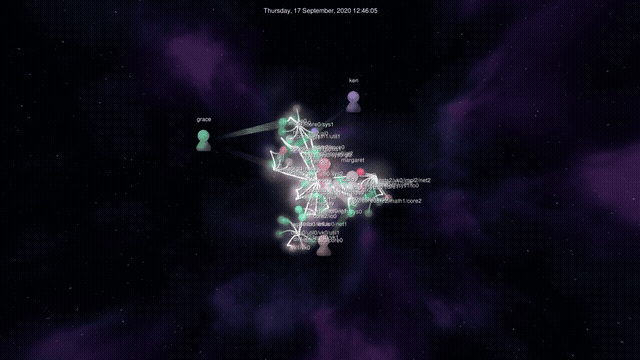
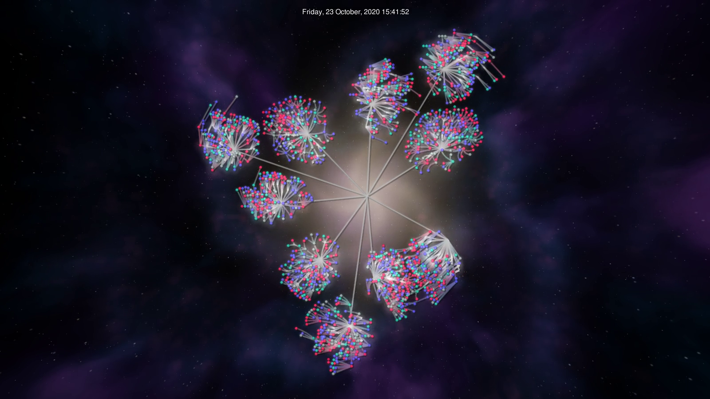
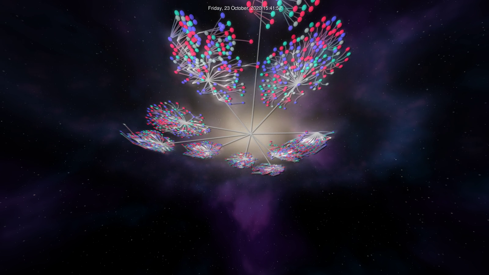
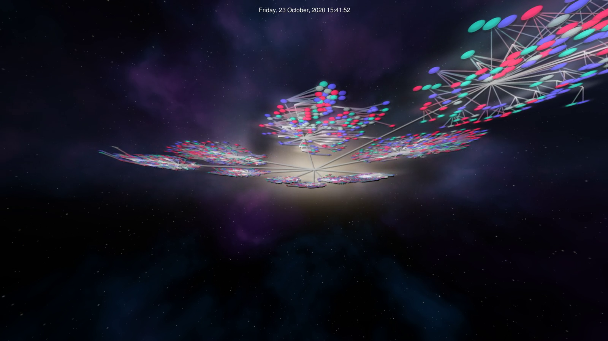
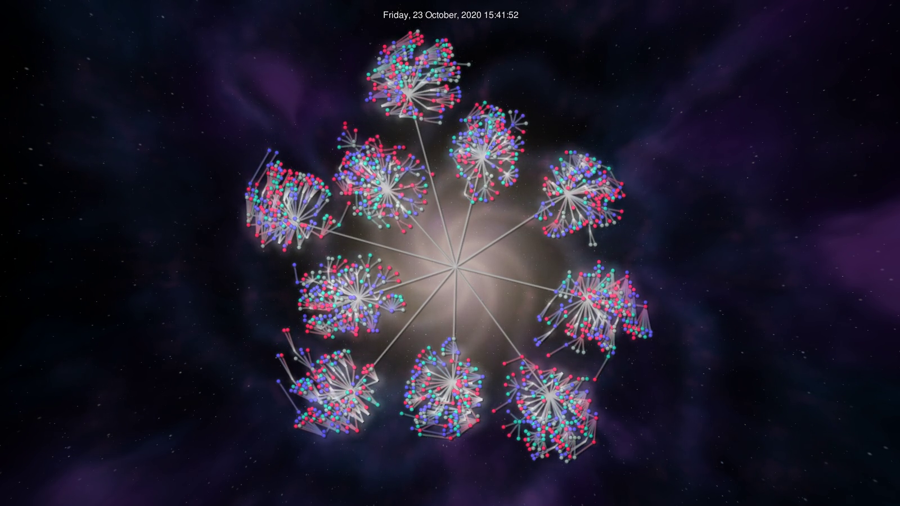

<h1 align="center">Gource Galaxy</h1>

<p align="center">
  <b>Your repository as a spiral galaxy.</b><br>
  A fork of <a href="https://gource.io">Gource 0.53</a> with a raymarched 3D nebula background,<br>
  spiral-arm directory layout, and a camera you can orbit and tilt.
</p>

<p align="center"></p>

| Top-down | Tilted 55° | Nearly edge-on |
|---|---|---|
|  |  |  |

> Stock Gource for comparison: [docs/images/stock.png](docs/images/stock.png)

---

## What's different from Gource

Everything Gource does still works: git, svn, hg, bzr and custom logs, video output via `--output-ppm-stream`, captions, `--key`, seeking, and so on. Galaxy mode adds the following.

### 1. A volumetric galaxy background

The background is a fragment shader that raymarches a 3D density field through **Gource's real camera matrices**. It is not a flat image behind the scene.

- A thin, flared **disc** with exponential falloff in radius and height
- A glowing **bulge** core
- **Spiral arms** from a logarithmic spiral, warped with 3D noise so they look clumpy rather than geometric
- **Dust lanes** on the inner edge of each arm that absorb the light behind them
- Pink **star-forming knots** inside the arms, warm yellow-white inner stars and blue outer arms
- A **skybox** of distant gas clouds and three layers of twinkling stars, fixed in direction so they hold still while you orbit

The volume lives in the same plane as the tree (world `z = 0`), so tilting the camera shows a proper 3D disc with the tree sitting on it.

### 2. Spiral-arm layout

Each top-level directory is dealt out to one of N arms. Its subdirectories are pulled toward that arm by a gentle tangential force, and Gource's usual forces still handle spacing and overlap.

The target angle depends only on a directory's **depth in the tree**:

```
angle = arm_angle + twist * ln(1 + depth * 80 / r0)
```

It deliberately does *not* depend on where the directory currently is. An earlier version aimed at the arm angle for the directory's current radius. Growing branches then chased a moving target and swung around like orbiting blobs. Depth-based targets keep the layout still.

### 3. Orbit and tilt

**Right-drag** orbits and tilts the camera around whatever it is looking at. The background reads the camera from the live modelview matrix, so it stays correct at any angle. Right-drag used to rotate the tree; `--no-galaxy` restores that.

### 4. Calmer defaults

- Bloom is lower (`--bloom-multiplier 0.6`, `--bloom-intensity 0.5`) so dense directories don't blow out to white.
- Auto-rotate is off in galaxy mode, because it spins the whole tree and fights the arms.

---

## Usage

```bat
gource-galaxy.bat C:\path\to\repo
gource-galaxy.bat C:\path\to\repo -1920x1080 --seconds-per-day 1 --galaxy-arms 5
```

No repo handy? Make a demo log:

```bat
python tools\make_demo_log.py > demo.log
gource-galaxy.bat demo.log
```

### New options

| Option | Default | What it does |
|---|---|---|
| `--galaxy-arms N` | `4` | Number of spiral arms (1 to 12) |
| `--galaxy-twist F` | `2.0` | Radians of winding per e-fold of radius. Higher means a tighter spiral |
| `--galaxy-pull F` | `1.5` | How hard directories are pulled onto an arm |
| `--galaxy-width F` | `0.28` | Half width of an arm in radians. No pull inside it |
| `--galaxy-spin F` | `0` | Rotation of the arm pattern, radians per second |
| `--galaxy-tilt DEG` | `0` | Start tilted away from top-down |
| `--galaxy-orbit DEG` | `0` | Start orbited around the galaxy |
| `--nebula-brightness F` | `1.0` | Background brightness |
| `--no-galaxy` | | Stock layout and right-drag rotation |
| `--no-nebula` | | Stock flat background |

Run `gource --help -H` for the full list.

Six arms with a tighter twist (`--galaxy-arms 6 --galaxy-twist 2.6`):

<p align="center"></p>

### Recording video

```bat
gource.exe C:\path\to\repo -1920x1080 -r 60 --output-ppm-stream - ^
  | ffmpeg -y -r 60 -f image2pipe -vcodec ppm -i - -c:v libx264 -pix_fmt yuv420p galaxy.mp4
```

Use `--galaxy-tilt` and `--galaxy-orbit` to pick the viewing angle, since right-drag only works in the live window.

---

## Download

Prebuilt Windows x64 binaries are on the [Releases](../../releases) page. Unzip and run `gource-galaxy.bat`. You need a GPU with OpenGL 2.0 or newer.

## Building from source

Windows, using [MSYS2](https://www.msys2.org) **UCRT64**:

```bash
pacman -S --needed mingw-w64-ucrt-x86_64-{gcc,SDL2,SDL2_image,glew,glm,boost,freetype,pcre2,libpng,libjpeg-turbo,pkgconf} \
                   autoconf automake libtool make
./build.sh      # builds /tmp/g/gource.exe
./package.sh    # collects exe + DLLs + data into ./dist
```

Notes:

- Keep the MSYS2 install in a path **without spaces**. pkg-config output breaks otherwise.
- `build.sh` pre-answers a few `configure` link checks (SDL2_image, Boost.Filesystem) that fail on current MSYS2 packages even though the libraries are installed.
- `gource_settings.cpp` uses `path.extension()` instead of the free function `extension(path)`, which newer Boost removed.

## Where the changes are

| File | Change |
|---|---|
| `src/src/galaxy.h`, `galaxy.cpp` | New. Layout force, arm assignment, the background shader and its camera plumbing |
| `src/src/dirnode.cpp` | Calls `galaxyForce` from `applyForces` |
| `src/src/zoomcamera.cpp` | Orbit and tilt applied in view space, before the look-at |
| `src/src/gource.cpp` | Draws the background, feeds it the camera and galaxy radius, right-drag orbit |
| `src/src/gource_settings.cpp` | New options, dimmer bloom defaults, `extension()` fix |

## Known issues

- With few, large top-level directories you get a ring of clusters around the core more than long arms. The background arms are the main spiral cue. More top-level directories, `--galaxy-pull` and `--galaxy-width` help.
- The background arms follow a spiral in world radius, while the layout aims by directory depth, so the two line up loosely rather than exactly.
- Mouse hover and click picking are not corrected for tilt, so they can be off when tilted.
- The raymarcher costs GPU time at high resolutions. 1080p is fine on a mid-range card; 4K recording wants something stronger.
- Tested on Windows 11 only.

## Credits and license

Built on [Gource](https://github.com/acaudwell/Gource) by Andrew Caudwell and contributors (see `src/THANKS`). Gource is GPL-3.0, so this fork is too. See [LICENSE](LICENSE). The original Gource README is in `src/README.md`.
